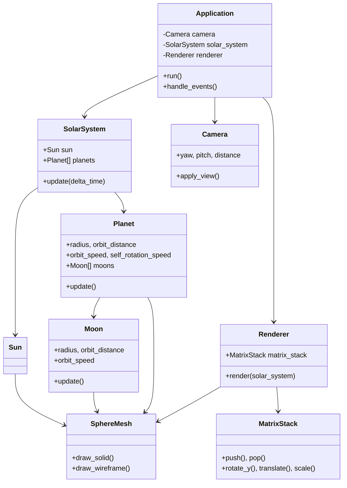

# Hierarchical Solar System Simulator

A real-time **Computer Graphics capstone project** built with **Python**, **PyOpenGL**, **GLUT**, and **NumPy**. It demonstrates hierarchical modeling, matrix transformations, parametric animation, and interactive camera controls — without external assets, textures, or 3D models.

---

## Features

- **1 Sun** at the origin with **8 planets** and **4 moons** (Earth, Mars×2, Jupiter)
- **Hierarchical transforms** via a custom `MatrixStack` (equivalent to `glPushMatrix` / `glPopMatrix`)
- **Programmatic spheres** using parametric coordinates and `GL_TRIANGLES`
- **Orbital paths** drawn with `GL_LINE_LOOP`
- **Delta-time animation** at 60 FPS target
- **Keyboard controls** for speed, pause, reverse, planet sizing
- **Mouse camera** — drag to orbit, scroll to zoom, `C` to reset
- **Flat colors only** — no imported assets

---

## Installation

### Prerequisites

- Python 3.10+ (tested with 3.14)
- pip

### Setup

```bash
cd "Capstone project"
pip install -r requirements.txt
```

### Run

```bash
python main.py
```

---

## Controls

| Input | Action |
|-------|--------|
| **↑ / ↓** | Increase / decrease simulation speed |
| **SPACE** | Pause / resume animation |
| **R** | Reverse orbital direction |
| **+ / =** | Increase selected planet size |
| **-** | Decrease selected planet size |
| **← / →** | Cycle selected planet |
| **C** | Reset camera |
| **H** | Toggle HUD |
| **ESC** | Exit |
| **Mouse drag** | Rotate view around the solar system |
| **Mouse wheel** | Zoom in / out |

---

## Project Structure

```
Capstone project/
├── main.py                  # Entry point
├── requirements.txt         # Dependencies
├── README.md                # This file
└── src/
    ├── __init__.py
    ├── application.py       # Main loop, input, timing
    ├── camera.py            # Spherical orbit camera
    ├── celestial_body.py    # Sun, Planet, Moon classes
    ├── hud.py               # 2D text overlay
    ├── matrix_stack.py      # 4x4 matrix stack (hierarchical modeling)
    ├── renderer.py          # OpenGL drawing + transform hierarchy
    ├── solar_system.py      # Scene graph / simulation state
    └── sphere.py            # Procedural sphere mesh + orbit paths
```

---

## Architecture



### Class Responsibilities

| Class | Responsibility |
|-------|----------------|
| `Application` | Window lifecycle, event loop, delta time, HUD |
| `SolarSystem` | Owns all bodies; simulation speed/pause/reverse state |
| `Planet` / `Moon` / `Sun` | Orbital parameters, mesh, per-frame angle updates |
| `MatrixStack` | Hierarchical 4×4 affine transforms with push/pop |
| `Renderer` | Projection setup, hierarchical draw order, orbit paths |
| `Camera` | View matrix from spherical coordinates |
| `SphereMesh` | Procedural vertex generation and drawing |

---

## Hierarchical Modeling

Each frame, the renderer builds transforms in parent→child order:

```
Sun (identity)
└── Planet
      1. Rotate(orbit_angle)      ← orbit around Sun (Y axis)
      2. Translate(orbit_distance)
      3. Rotate(self_rotation)    ← spin on own axis
      4. Scale(size_multiplier)
      └── Moon
            1. PushMatrix()       ← inherit planet transform
            2. Rotate(moon_angle)
            3. Translate(moon_distance)
            4. Draw moon
            5. PopMatrix()
```

This is the core graphics concept: **a moon's world position = planet transform × moon transform**. The matrix stack saves/restores the planet's accumulated matrix so each moon starts from the planet's frame of reference.

---

## Mathematical Operations

### 1. Orbital Position (Parametric Circle)

Planets use rotation + translation instead of explicit `(x, z)` each frame, but the result is equivalent:

```
x = distance × cos(θ)
z = distance × sin(θ)
```

where `θ` (orbit angle) is updated each frame:

```
θ += orbit_speed × Δt × speed_multiplier
```

### 2. Y-Axis Rotation Matrix

```
R_y(θ) = |  cos(θ)   0   sin(θ)   0 |
         |    0      1     0      0 |
         | -sin(θ)   0   cos(θ)   0 |
         |    0      0     0      1 |
```

Applied as column vectors: **p′ = R_y · p**

### 3. Translation Matrix

```
T(x, y, z) = | 1  0  0  x |
             | 0  1  0  y |
             | 0  0  0  z |
             | 0  0  0  1 |
```

### 4. Composite Transform

For a moon, the full model matrix is:

```
M_moon = R_orbit · T_planet_dist · R_self · R_moon · T_moon_dist
```

Matrix multiplication order matters: transforms are applied **right-to-left** on column vectors.

### 5. Sphere Parametric Equations

```
x = r · sin(φ) · cos(θ)
y = r · cos(φ)
z = r · sin(φ) · sin(θ)
```

- φ ∈ [0, π] — latitude (stacks)
- θ ∈ [0, 2π] — longitude (slices)

### 6. Camera (Spherical Coordinates)

```
eye_x = distance · cos(pitch) · sin(yaw)
eye_y = distance · sin(pitch)
eye_z = distance · cos(pitch) · cos(yaw)
```

The camera always looks at the origin `(0, 0, 0)`.

---

## Screenshots

> Run the simulator and capture screenshots for your submission:
>
> 1. Default view showing all orbital paths
> 2. Close-up of Earth + Moon hierarchy
> 3. Paused state with HUD visible
> 4. Reverse orbit direction

Save screenshots to a `screenshots/` folder for your report.

---

## Implementation Plan (How This Was Built)

1. **Matrix stack** — NumPy 4×4 transforms with push/pop
2. **Sphere generator** — parametric mesh with `GL_TRIANGLES`
3. **Celestial bodies** — data classes with update logic
4. **Solar system** — 8 planets, 4 moons, simulation state
5. **Renderer** — hierarchical draw using matrix stack
6. **Camera** — mouse orbit + zoom
7. **Application** — Pygame loop, 60 FPS, delta time, input
8. **HUD** — texture overlay for on-screen controls

---

## Future Improvements (To Impress Your Instructor)

1. **Saturn's rings** — procedurally generated `GL_LINE_LOOP` or thin triangle strip torus
2. **Phong lighting** — move to shaders (GLSL) with per-fragment normals from sphere mesh
3. **Starfield background** — random point cloud on a large sphere (still no external assets)
4. **Planet labels** — billboard text quads always facing the camera
5. **Shadow projection** — project moons onto planets using a simple planar shadow matrix
6. **Trace mode** — draw each body's trail as a fading `GL_LINE_STRIP`
7. **Split view** — top-down orthographic + perspective side-by-side
8. **Quaternion camera** — replace Euler angles to avoid gimbal lock
9. **Instanced rendering** — draw asteroid belt with one mesh + many transform matrices
10. **Frame timing graph** — debug overlay showing FPS and delta time histogram

---

## Educational Concepts Demonstrated

- Affine transformations (rotation, translation, scale)
- Homogeneous 4×4 coordinates
- Hierarchical scene graph / matrix stack
- Graphics state management (projection vs modelview)
- Parametric curves (circles, spheres)
- Timer-based animation with delta time
- Interactive user controls (keyboard + mouse)
- Real-time rendering pipeline (clear → transform → draw → swap)

---

## License

Educational use — Computer Graphics Capstone Project.


